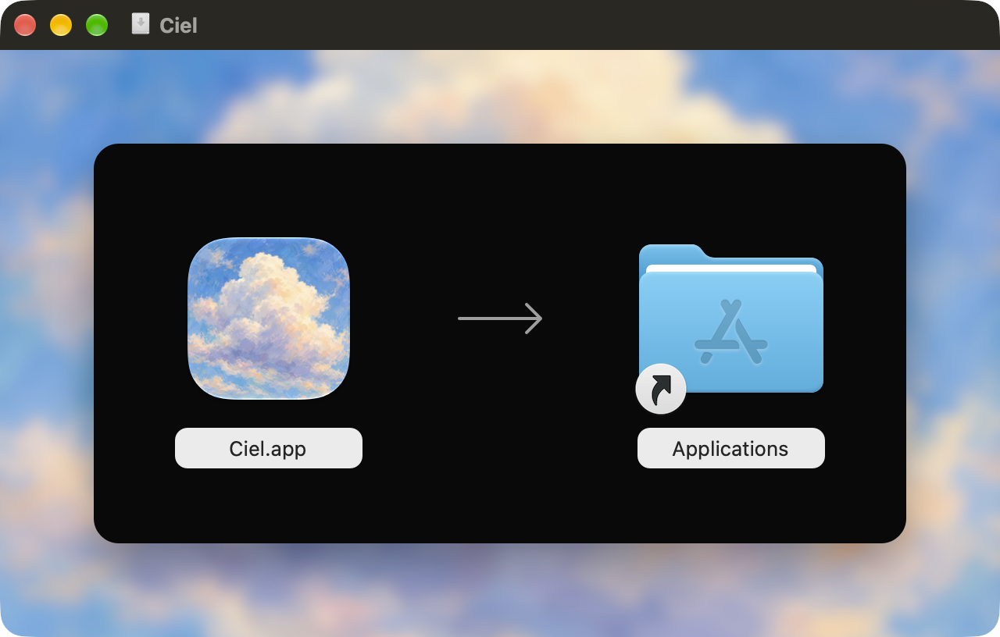

# Ciel design system

Ciel opens as one empty black input box. Nothing but the caret shows until the user types.

- Keep the UI minimal and black. Add no chrome, color, text, counts, hints, tabs or controls unless the operator asks.
- Every surface is opaque and dark, in macOS light and dark appearance. App icons keep their own colors, and an error uses system red with its message.
- Use only the gray tokens in `Sources/Ciel/DesignSystem.swift`. Colors, labels, switches and the About panel come from that file. `scripts/lint-colors.sh` fails on one built anywhere else and names the token to use.
- Keep keyboard actions immediate: opening, closing, typing, selection and resizing never animate. Use motion only for pointer feedback and the dictation pills. Reduce Motion and the app's animation switch turn it off.
- Use native text editing, focus and accessibility labels. Check light and dark appearance, Reduce Motion, Reduce Transparency and Increase Contrast.
- Keep the cloud painting in the app icon and the disk image, out of the daily interface. `scripts/dmg.sh` builds the disk image window below.

